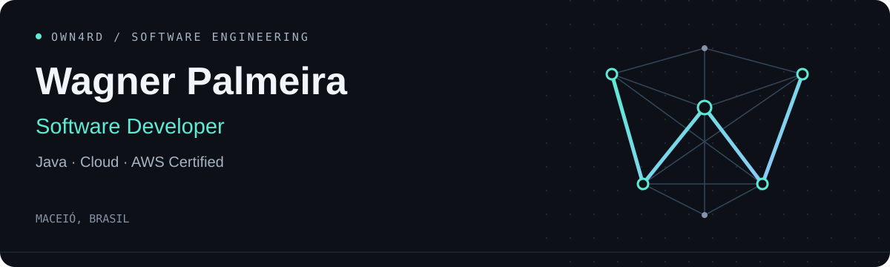

  

  <a href="https://www.linkedin.com/in/wagner-palmeira-ti/">LinkedIn</a> ·
  <a href="http://lattes.cnpq.br/2322442029489078">Lattes</a> ·
  <a href="mailto:wagnerpalmeira.ti@gmail.com">Contato</a>

## Olá, sou o Wagner 👋

Desenvolvedor de software em Maceió, Alagoas, com experiência em **Java, desenvolvimento full stack e ambientes cloud**. Trabalho na modernização de aplicações e na construção de soluções para setores como finanças, saúde, educação e serviços públicos.

Minha atuação vai da manutenção de sistemas legados ao desenvolvimento de APIs e serviços com **Spring Boot e Quarkus**, incluindo interfaces com **React e TypeScript**. Valorizo colaboração, aprendizado contínuo e decisões de arquitetura que façam sentido para o problema.

## Experiência

- **Modernização de sistemas:** manutenção e evolução de aplicações Java e participação na migração de sistemas legados para Python/Django.
- **Desenvolvimento de produtos:** soluções para seguros, receituário eletrônico e gestão da alimentação escolar, com atuação em backend e frontend.
- **Cloud e entrega:** experiência com AWS, Azure, Docker, Kubernetes e Argo CD.
- **Qualidade e segurança:** testes unitários e de integração, autenticação com Keycloak e Spring Security e monitoramento de aplicações.

## Tech Stack

| Área | Tecnologias |
| --- | --- |
| Backend | Java · Spring Boot · Quarkus · Python · Django |
| Frontend | React · TypeScript · JavaScript · HTML · CSS |
| Dados | PostgreSQL · Hibernate · Spring Data |
| Cloud e DevOps | AWS · Azure · Docker · Kubernetes · Argo CD · GitHub Actions |
| Testes | JUnit · Mockito · Testcontainers · Pytest |
| Segurança e observabilidade | Keycloak · Spring Security · Dynatrace · Sentry |

## Formação e certificação

🎓 **Mestre em Engenharia de Software** — CESAR School  
☁️ **AWS Certified**

- MBA em Engenharia de Software com IA — Full Cycle **(em andamento)**.
- Especialização em Engenharia de Software — CESMAC.
- Especialização em Docência no Ensino Superior — Senac São Paulo.
- Bacharelado em Análise de Sistemas — CESMAC.

---

[Explore meus repositórios →](https://github.com/own4rd?tab=repositories) · [Vamos conversar →](https://www.linkedin.com/in/wagner-palmeira-ti/)
